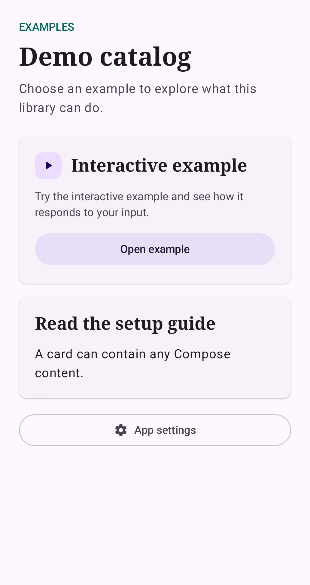
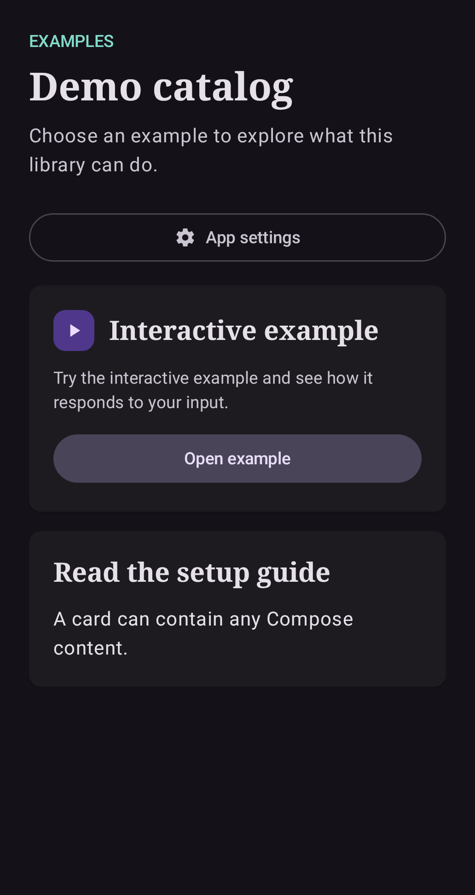
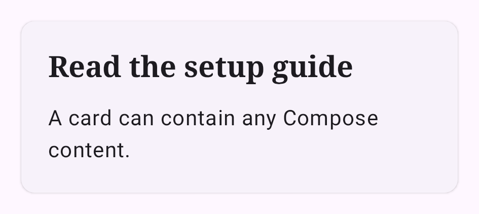
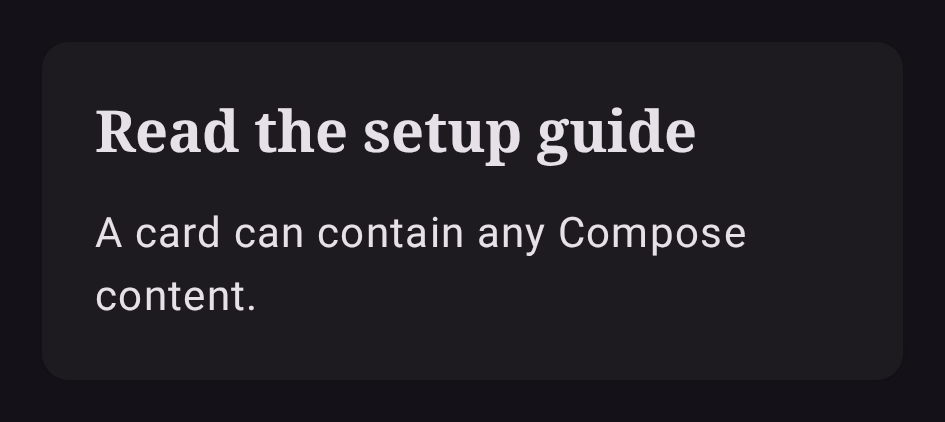
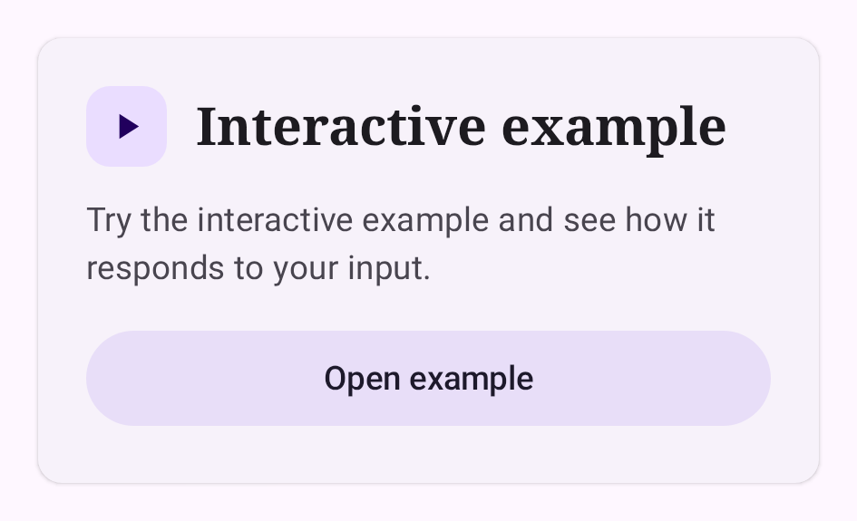
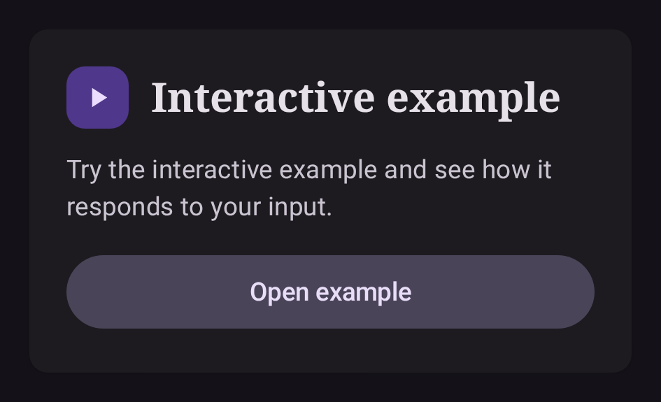
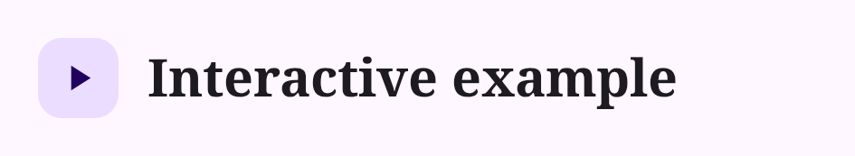

# API de Compose

Importa estas declaraciones de `com.apexfission.android.democommon`. Llámalas
desde una composición Material 3 existente. Todas aceptan el `Modifier` de la
aplicación que las llama y devuelven `Unit`.

Todas las imágenes usan el tema Material 3 de la aplicación de ejemplo; los componentes adoptan el tema de tu aplicación.

## DemoScreen

| Claro | Oscuro |
| --- | --- |
|  |  |

```kotlin
@Composable
public fun DemoScreen(
    title: String,
    welcomeNote: String,
    modifier: Modifier = Modifier,
    eyebrow: String? = null,
    maxContentWidth: Dp = 640.dp,
    contentPadding: PaddingValues = PaddingValues(24.dp),
    contentWindowInsets: WindowInsets = ScaffoldDefaults.contentWindowInsets,
    itemSpacing: Dp = 16.dp,
    showEmptyState: Boolean = false,
    onOpenSettings: (() -> Unit)? = null,
    content: LazyListScope.() -> Unit = {},
)
```

Proporciona texto localizado y declara las tarjetas con `item` o `items`. Usa
claves estables para listas que cambian. La pantalla ocupa el espacio disponible,
combina `contentWindowInsets` de Scaffold con `contentPadding` sin recortar el
desplazamiento de borde a borde y centra su columna diferida dentro del ancho
máximo configurado. Usa `showEmptyState = true` cuando no haya demostraciones.
El panel vacío usa el tema Material 3 anfitrión y las cadenas localizadas de la
biblioteca. Proporciona `onOpenSettings` para agregar un botón de ajustes de la
aplicación de ancho completo después del contenido personalizado del catálogo
y antes del panel vacío, cuando se muestra. La función proporcionada por la aplicación anfitriona controla la
navegación, por ejemplo, abrir los ajustes de información de la aplicación en
Android. Dale a esta pantalla una altura acotada y evita anidarla dentro de un
contenedor con desplazamiento vertical.

## DemoCard

Sobrecarga de contenido personalizado.

| Claro | Oscuro |
| --- | --- |
|  |  |

```kotlin
@Composable
public fun DemoCard(
    modifier: Modifier = Modifier,
    contentPadding: PaddingValues = PaddingValues(20.dp),
    itemSpacing: Dp = 12.dp,
    content: @Composable ColumnScope.() -> Unit,
)
```

La tarjeta ocupa todo el ancho disponible y usa los valores predeterminados de
tarjeta de Material 3 del tema anfitrión. El contenido controla el estado de las
interacciones, las etiquetas de accesibilidad y las funciones de respuesta.
Usa un botón Material dentro del bloque de contenido para abrir la demostración
seleccionada.

Para la tarjeta estándar del catálogo de bienvenida, llama a la sobrecarga con
`title`, `description`, `actionLabel` y `onClick`. Muestra un `CardTitle` con un
`icon` opcional, seguido de la descripción y un botón tonal relleno de ancho
completo. Usa el bloque de contenido anterior para tarjetas personalizadas.

Sobrecarga con título, descripción y acción.

| Claro | Oscuro |
| --- | --- |
|  |  |

```kotlin
@Composable
public fun DemoCard(
    title: String,
    description: String,
    actionLabel: String,
    onClick: () -> Unit,
    modifier: Modifier = Modifier,
    icon: ImageVector? = null,
)
```

## CardTitle

| Claro | Oscuro |
| --- | --- |
|  |  |

```kotlin
@Composable
public fun CardTitle(
    title: String,
    modifier: Modifier = Modifier,
    icon: ImageVector? = null,
)
```

El título tiene semántica de encabezado para TalkBack. El icono es decorativo.
Incluye cualquier información de estado esencial en el texto. El tema aporta la
tipografía y los colores. No hay funciones de respuesta, tareas en segundo plano,
permisos de Android ni recursos que cerrar.

La aplicación anfitriona proporciona colores, formas y tipografía mediante
`MaterialTheme`. `DemoScreen` usa `headlineLarge` para su encabezado y `CardTitle`
usa `titleLarge`. Configura el peso de esos estilos en el tema anfitrión para
reproducir el encabezado en negrita de la pantalla y el título de tarjeta en
seminegrita del ejemplo de bienvenida.
