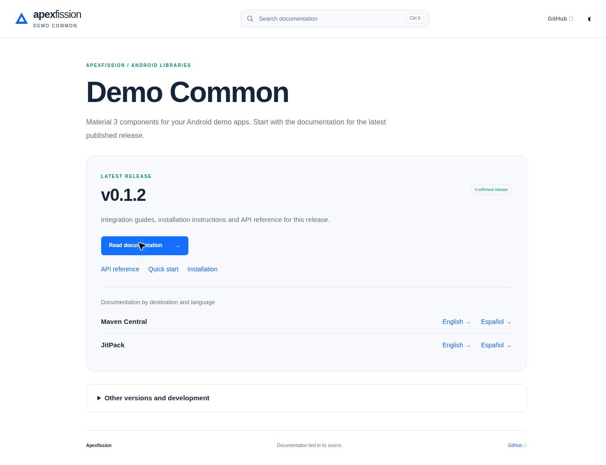

# Documentation website



The shared Rust CLI prepares versioned content and Zola 0.23.6 renders it with the bundled Apexfission documentation theme. No Python or Node.js is required to build this website. Install [CLI v0.1.9](https://github.com/lambdawalker/gradle.android-repo-setup/releases/tag/v0.1.9), pinned in `.project/setup/config.yaml`, and [Zola 0.23.6](https://github.com/getzola/zola/releases/tag/v0.23.6); verify the archive checksum before placing binaries on PATH. CI installs its checksum-pinned Zola automatically.

With the released CLI on PATH (Cargo is not required for downloaded binaries), run from the repository root:

```sh
android-repo-setup build_docs --check
```

Output is `sites/dist/`, including search indexes and raw Markdown. To inspect it locally, serve the repository root with any static HTTP server and open `/sites/dist/`; use a build with `--base /sites/dist` for that preview. Production uses `/android.apexfission.demo-common` as its URL base. The base path must match the directory your server exposes.

## Content ownership

| Content | Source |
| --- | --- |
| English consumer guides | `docs/agents/`, including nested Markdown files |
| Spanish guides | Matching `docs/es/` files |
| Reviewed translation freshness | `docs/es/translations.json`, SHA-256 of each exact English source |
| Confirmed releases and provenance | `docs/releases/history/demo-common/` |
| Current installation | Generated `IMPORT.md`, using `docs/templates/MODULE_IMPORT.md.template` |
| Build configuration | `sites/zola.toml` |
| Shared layout, styling and browser controls | `gradle.android-repo-setup/cli/site-theme/` |

The CLI stages Markdown and theme files in a temporary directory. Builds never execute historical scripts or rewrite canonical guides. Historical code and documentation revisions remain visible separately. Provider-specific installation instructions come only from that release's confirmed destinations. Development is explicitly unreleased, and missing/stale translations show English from the selected revision with a visible fallback notice. Corrections may use a retained translation tree without changing the release's code identity.

Canonical pages use `/en/demo-common/<version>/` and `/es/demo-common/<version>/`, with `/raw/*.md` companions. `versions.json` describes scopes for selectors and integrations. Previous `/<version>/<language>/*.html` links remain available. Root `IMPORT.md`, `llms.txt` and `agents/*.md` remain available to tools.

The Documentation workflow builds and checks PRs and publishes only main through GitHub Pages. Release completion also triggers documentation. Never publish a new Android artifact merely to retry a website build. Keep Pages configured to use GitHub Actions.

`build_docs --check` validates local generated links, anchors, images and raw Markdown endpoints; it does not verify external network availability or render Android UI. Site controls provide theme preference, scoped search and version/language switching that preserves the guide when available. If a guide is missing in the target scope, the selector explains the index fallback.

Do not edit generated output. For repository-specific layout changes, override bundled template files under `sites/templates/` or static assets under `sites/static/` and rerun the complete build/check.
